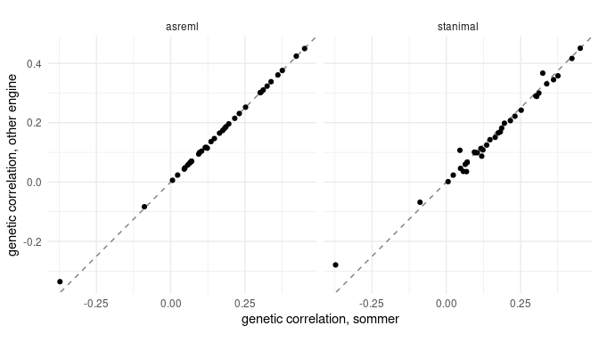
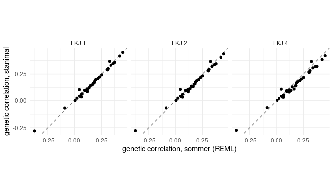

This vignette estimates the additive genetic covariance matrix **G** of nine
growth traits in mice with each of indri's three engines, shows how to read a
fit, and gives a rule for choosing the prior of the Bayesian engine. It was
precomputed: the fits take from seconds (REML) to many minutes (stanimal).

## How indri estimates G

A multivariate animal model on many traits is expensive: the number of
parameters grows with the square of the number of traits, and fitting all of
them at once is slow and often unstable. indri, following LiMMBo (Meyer et al.
2018), fits many small animal models instead, each on a subset of the traits,
so that every pair of traits is estimated in several subsets. It then averages
the subset estimates of each covariance and projects the result onto the
positive semi-definite matrices, so that the assembled `G` is a covariance
matrix. The small fit is done by a pluggable **engine**: `"sommer"` and
`"asreml"` (REML) or `"stanimal"` (a Bayesian sampler).

## The data

An F3 intercross of two inbred mouse strains selected for large (LG/J) and
small (SM/J) body size ships with indri. The parental strains are fully
inbred and the F1 all heterozygous, so the F2 parents of the F3 are unrelated
founders, and the F3 mice are related only through them: full sibs (1/2) and,
for nine sires with two mates, half sibs (1/4). `lgsm_A` is that relationship
matrix. The traits are the nine weekly weight gains (`growth12`, the gain from
week 1 to week 2, to `growth910`), and the fixed effects those of the original
analyses: sex, rearing cohort and litter size at birth and at weaning.


``` r
# The data every vignette uses: the nine weekly weight gains of the LG/SM F3
# mice, with the fixed effects of the original analyses.
library(indri)
traits <- lgsm_traits$growth
d <- lgsm_f3[lgsm_f3$ID %in% rownames(lgsm_genotypes$A), ]
d <- d[stats::complete.cases(d[c(traits, "LSB", "LSW")]), ]
Y <- as.matrix(d[traits])
rownames(Y) <- d$ID
X <- stats::model.matrix(~ SEX + factor(COHORT) + LSB + LSW, d)
rownames(X) <- d$ID
A <- lgsm_A[rownames(Y), rownames(Y)]
dosage <- lgsm_genotypes$A[rownames(Y), ] + 1
info <- transform(lgsm_markers, pos = cM)
cores <- as.integer(Sys.getenv("INDRI_VIGNETTE_CORES", "2"))
dir.create("cache", showWarnings = FALSE)
```


``` r
dim(Y)
#> [1] 1548    9
round(colMeans(Y), 2)
#>  growth12  growth23  growth34  growth45  growth56  growth67  growth78  growth89 
#>      3.06      3.83      6.14      4.45      1.81      1.41      1.34      1.19 
#> growth910 
#>      1.02
```

One caveat before any fit: the full sibs also share a mother and a litter,
and indri's models have one random effect, the additive one. Variance shared
by littermates (maternal effects, a common nest) therefore ends up partly in
`G`. Some pups were cross-fostered, which separates the litter environment
from the mother, but the model here does not use it. Read the `G` below as an
additive-plus-litter covariance; the original analyses included a dam effect.

## Three engines on the same data

All three engines take the same call; only `engine` changes. The REML engines
run in seconds:


``` r
time_sommer <- system.time(
  fit_sommer <- fit_G(Y, X = X, A = A, engine = "sommer", cores = cores,
                      seed = 1L, progress = FALSE))
fit_sommer
#> <indri fit>
#>   traits:            9
#>   individuals:       1548
#>   engine:            sommer
#>   subsets:           16 of up to 4 traits
#>   assembly:          ls (none weights)
#>   pair coverage:     1 to 4
#>   min eigenvalue:    0.1431
#> 
#> G (first entries):
#>          growth12 growth23 growth34 growth45
#> growth12    0.272    0.027    0.002    0.086
#> growth23    0.027    0.803    0.234   -0.334
#> growth34    0.002    0.234    0.648    0.109
#> growth45    0.086   -0.334    0.109    0.997
```


``` r
has_asreml <- nzchar(system.file(package = "asreml"))
if (has_asreml) {
  time_asreml <- system.time(
    fit_asreml <- fit_G(Y, X = X, A = A, engine = "asreml", cores = 2L,
                        seed = 1L, progress = FALSE))
}
```

asreml needs a licence seat per worker; a standard licence allows two
processes on one machine, hence `cores = 2`.

The stanimal engine samples each block's posterior with CmdStan. It is far
slower, and gives posterior draws instead of a normal approximation. Each
block runs four chains here, so a budget of `cores` processes runs
`cores / 4` blocks at a time:


``` r
stan_args <- list(chains = 4L, iter = 2000L, refresh = 0,
                  show_messages = FALSE)
time_stanimal <- system.time(
  fit_stanimal <- fit_G(Y, X = X, A = A, engine = "stanimal",
                        engine_args = stan_args, cores = cores, seed = 1L,
                        progress = FALSE))
#> Warning: Several blocks failed to converge: 6 of 33 have rank-normalised
#> split-Rhat >= 1.05 on G (max 1.15). The likelihood may not identify the genetic
#> correlations strongly enough with these data. Consider increasing the LKJ prior
#> parameter, e.g. `engine_args = list(lkj_prior = 2)` (this fit used 1), which
#> regularises the block correlations; longer chains do not help when block
#> posteriors are poorly identified. See `fit$diagnostics$unconverged`.
```


``` r
fits <- list(sommer = fit_sommer, stanimal = fit_stanimal)
if (has_asreml) fits <- c(fits[1], list(asreml = fit_asreml), fits[2])
times <- c(sommer = time_sommer[["elapsed"]],
           asreml = if (has_asreml) time_asreml[["elapsed"]],
           stanimal = time_stanimal[["elapsed"]])
upper <- function(m) m[upper.tri(m)]
agree <- vapply(fits, function(f) cor(upper(f$corrG), upper(fit_sommer$corrG)),
                numeric(1))
data.frame(
  engine = names(fits),
  seconds = round(times[names(fits)]),
  blocks = vapply(fits, function(f) nrow(f$subsets), integer(1)),
  mean_abs_corrG = vapply(fits, function(f) mean(abs(upper(f$corrG))), numeric(1)),
  corr_with_sommer = vapply(fits, function(f)
    cor(upper(f$corrG), upper(fit_sommer$corrG)), numeric(1)),
  row.names = NULL)
#>     engine seconds blocks mean_abs_corrG corr_with_sommer
#> 1   sommer      17     16      0.1844255        1.0000000
#> 2   asreml      27     16      0.1828312        0.9994066
#> 3 stanimal    1076     33      0.1762084        0.9900802
```


``` r
library(ggplot2)
pairs <- do.call(rbind, lapply(names(fits)[-1], function(e)
  data.frame(engine = e, sommer = upper(fit_sommer$corrG),
             other = upper(fits[[e]]$corrG))))
ggplot(pairs, aes(sommer, other)) +
  geom_abline(linetype = "dashed", colour = "grey50") +
  geom_point() + facet_wrap(~ engine) + coord_equal() +
  labs(x = "genetic correlation, sommer", y = "genetic correlation, other engine") +
  theme_minimal()
```



The two REML engines fit the same model by the same criterion and agree
almost exactly (their genetic correlations correlate at
0.999). stanimal's
agree closely too (0.99), at
18 minutes against seconds: it fits each
pair in three blocks (33 here, against
16 for REML) and samples each with four chains.
Its correlations are a little closer to zero, the pull of the prior,
which the next section examines.

## Reading a fit


``` r
round(fit_sommer$corrG, 2)
#>           growth12 growth23 growth34 growth45 growth56 growth67 growth78
#> growth12      1.00     0.06     0.01     0.16     0.38     0.07     0.12
#> growth23      0.06     1.00     0.32    -0.37     0.07    -0.09     0.05
#> growth34      0.01     0.32     1.00     0.14     0.18     0.05     0.09
#> growth45      0.16    -0.37     0.14     1.00     0.45     0.42     0.20
#> growth56      0.38     0.07     0.18     0.45     1.00     0.34     0.15
#> growth67      0.07    -0.09     0.05     0.42     0.34     1.00     0.30
#> growth78      0.12     0.05     0.09     0.20     0.15     0.30     1.00
#> growth89      0.25     0.12     0.10     0.10     0.36     0.31     0.07
#> growth910     0.06     0.12     0.22     0.02     0.30     0.19     0.23
#>           growth89 growth910
#> growth12      0.25      0.06
#> growth23      0.12      0.12
#> growth34      0.10      0.22
#> growth45      0.10      0.02
#> growth56      0.36      0.30
#> growth67      0.31      0.19
#> growth78      0.07      0.23
#> growth89      1.00      0.18
#> growth910     0.18      1.00
round(sqrt(diag(fit_sommer$G)), 2)     # genetic standard deviations, in grams
#>  growth12  growth23  growth34  growth45  growth56  growth67  growth78  growth89 
#>      0.52      0.90      0.81      1.00      0.64      0.61      0.53      0.55 
#> growth910 
#>      0.55
summary(fit_sommer)$min_eigenvalue
#> [1] 0.1430837
fit_sommer$diagnostics$n_unconverged
#> [1] 0
```

- `G` and `sigma_G` are in the units of the traits (grams, and grams
  squared); `corrG` holds the genetic correlations.
- Every pair of traits is estimated in several distinct blocks
  (`fit$coverage`); `G_bar` is their plain average, and `G` its projection
  onto the covariance matrices. The difference shows how much the
  projection had to change:


``` r
round(max(abs(fit_sommer$G - fit_sommer$G_bar)), 3)
#> [1] 0
```

- Intervals come from `corrG_draws`, which mixes each block's draws
  (posterior draws for stanimal, a normal approximation for the REML
  engines). They are intervals for each entry, not draws of a whole matrix:


``` r
lo <- apply(fit_sommer$corrG_draws, 1:2, quantile, 0.025)
hi <- apply(fit_sommer$corrG_draws, 1:2, quantile, 0.975)
data.frame(pair = c("growth12-growth23", "growth34-growth45", "growth12-growth910"),
           estimate = round(c(fit_sommer$corrG[1, 2], fit_sommer$corrG[3, 4],
                              fit_sommer$corrG[1, 9]), 2),
           lower = round(c(lo[1, 2], lo[3, 4], lo[1, 9]), 2),
           upper = round(c(hi[1, 2], hi[3, 4], hi[1, 9]), 2))
#>                 pair estimate lower upper
#> 1  growth12-growth23     0.06 -0.14  0.23
#> 2  growth34-growth45     0.14 -0.05  0.33
#> 3 growth12-growth910     0.06 -0.17  0.29
```

- `diagnostics` lists the blocks that did not converge: for the REML
  engines, optima that could not be certified (simulations found them as
  accurate as the rest); for stanimal, blocks with split-Rhat above 1.05 or
  divergent transitions, which deserve attention (next section).
- `E` is the residual covariance (the residual covariance after `X` minus
  `G`), used by the association scans of the next vignettes.

## Choosing the LKJ prior for stanimal

stanimal puts an LKJ prior on the correlation matrix of each block. With
`lkj_prior = 1` it is uniform over correlation matrices; larger values pull
the block correlations towards zero. indri's default for its blocks is 1. In
simulations of 12 to 35 traits on a few hundred individuals, blocks of up to
four traits under LKJ(1) gave 95% intervals that covered the true genetic
correlations about 95% of the time and the least shrinkage of strong
correlations; LKJ(2) shrank more and covered less (89-94%).

A stronger prior earns its keep when the data cannot identify the block
correlations: blocks whose chains disagree (split-Rhat at or above 1.05) or
diverge, which indri reports with a warning. On another mouse data set (35
skull traits, 329 mice) a third of the blocks did not mix under LKJ(1), and
longer chains did not help; a stronger prior is the remedy there, not more
iterations.

The same nine traits under three priors:


``` r
lkj_fits <- list(`1` = fit_stanimal)
for (eta in c(2, 4)) {
  lkj_fits[[as.character(eta)]] <- suppressWarnings(fit_G(
    Y, X = X, A = A, engine = "stanimal",
    engine_args = c(stan_args, list(lkj_prior = eta)), cores = cores,
    seed = 1L, progress = FALSE))
}
```


``` r
width <- function(f) mean(upper(apply(f$corrG_draws, 1:2, quantile, 0.975) -
                                  apply(f$corrG_draws, 1:2, quantile, 0.025)))
slope <- function(f) unname(coef(lm(upper(f$corrG) ~ upper(fit_sommer$corrG)))[2])
data.frame(
  lkj_prior = names(lkj_fits),
  blocks_not_mixing = vapply(lkj_fits, function(f) f$diagnostics$n_unconverged, numeric(1)),
  max_rhat = round(vapply(lkj_fits, function(f) f$diagnostics$max_rhat, numeric(1)), 3),
  mean_abs_corrG = round(vapply(lkj_fits, function(f) mean(abs(upper(f$corrG))), numeric(1)), 3),
  slope_on_sommer = round(vapply(lkj_fits, slope, numeric(1)), 2),
  interval_width = round(vapply(lkj_fits, width, numeric(1)), 2),
  row.names = NULL)
#>   lkj_prior blocks_not_mixing max_rhat mean_abs_corrG slope_on_sommer
#> 1         1                 6    1.154          0.176            0.93
#> 2         2                 6    1.152          0.171            0.90
#> 3         4                 6    1.145          0.162            0.87
#>   interval_width
#> 1           0.38
#> 2           0.37
#> 3           0.36
```


``` r
lkj_pairs <- do.call(rbind, lapply(names(lkj_fits), function(eta)
  data.frame(lkj = paste("LKJ", eta), sommer = upper(fit_sommer$corrG),
             stanimal = upper(lkj_fits[[eta]]$corrG))))
ggplot(lkj_pairs, aes(sommer, stanimal)) +
  geom_abline(linetype = "dashed", colour = "grey50") +
  geom_point() + facet_wrap(~ lkj) + coord_equal() +
  labs(x = "genetic correlation, sommer (REML)",
       y = "genetic correlation, stanimal") +
  theme_minimal()
```



A slope below 1 against the REML estimates is the prior's shrinkage. With
1548 mice the data dominate: from LKJ(1) to LKJ(4) the slope drops
only from 0.93 to
0.87 and the intervals barely narrow. As
many blocks fail to mix under every prior (six of 33); under LKJ(1) they
are:


``` r
fit_stanimal$diagnostics$unconverged
#>   block                                  traits     rhat divergences
#> 1     5  growth23, growth34, growth67, growth78 1.056629           0
#> 2     9 growth23, growth34, growth56, growth910 1.065716           0
#> 3    11  growth12, growth34, growth45, growth56 1.070626           0
#> 4    16  growth23, growth45, growth56, growth89 1.154291           0
#> 5    30  growth45, growth67, growth78, growth89 1.106724           0
#> 6    33 growth23, growth45, growth67, growth910 1.130273           0
```

A stronger prior does not reduce their number, so here the prior is not what
keeps them from mixing: those blocks need longer chains, or the REML estimates,
which agree with the mixed blocks. With a few hundred individuals, as in
the 35-trait data above, the prior matters much more. The rule of thumb:

1. **Start with the default, LKJ(1).** It is the least informative choice,
   and in simulations it gave nominal coverage.
2. **Look at `diagnostics`.** If blocks do not mix (Rhat >= 1.05, divergent
   transitions), refit with a stronger prior (2, then 4) and see whether
   they mix and the estimates move. If they mix only under the stronger
   prior, keep it and report it: the correlations are shrunk towards zero
   accordingly. If nothing changes, as here, the prior is not the problem:
   run longer chains, or rely on REML for those pairs.
3. **Compare with a REML engine.** sommer takes seconds; a stanimal fit far
   from it, beyond what the prior's shrinkage explains, is worth a second
   look.

## G against the phenotypic covariance


``` r
options(rgl.useNULL = TRUE)
suppressPackageStartupMessages(library(evolqg))
resid <- lm.fit(X, Y)$residuals
P <- crossprod(resid) / (nrow(Y) - ncol(X))
G <- fit_sommer$G
data.frame(
  comparison = c("random skewers", "Krzanowski (first 4 PCs)", "Mantel (correlations)"),
  similarity = round(c(RandomSkewers(G, P)[[1]],
                       KrzCor(G, P, ret.dim = 4),
                       MantelCor(cov2cor(G), cov2cor(P), permutations = 999)[[1]]), 2))
#>                 comparison similarity
#> 1           random skewers       0.91
#> 2 Krzanowski (first 4 PCs)       0.74
#> 3    Mantel (correlations)       0.73
integration <- c(G = CalcEigenVar(cov2cor(G)), P = CalcEigenVar(cov2cor(P)))
integration
#>          G          P 
#> 0.04903135 0.01478441
```

`G` and the phenotypic covariance `P` point the same way (random skewers
0.91: the two respond alike to the same
selection), but `G` is the more integrated, its correlations concentrated
in fewer directions (relative eigenvalue variance
0.049 against 0.015).
Residual variation spreads `P` out over more directions than the genetic
variation alone.


## Summary

- The three engines estimate the same `G`; sommer and asreml agree closely
  and take seconds, stanimal takes much longer and gives posterior draws.
- Start stanimal at LKJ(1). Raise the prior for blocks that do not mix
  only if that makes them mix; with many individuals, as here, it changes
  little.
- `G` here includes variance shared by littermates.

## Reference

Meyer, H. V., Casale, F. P., Stegle, O. and Birney, E. (2018). LiMMBo: a
simple, scalable approach for linear mixed models in high-dimensional genetic
association studies. *bioRxiv*. <https://doi.org/10.1101/255497>
