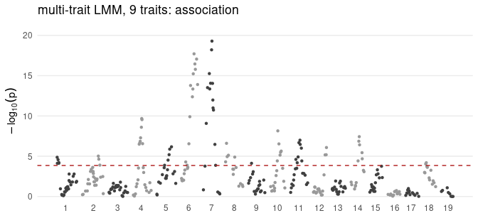
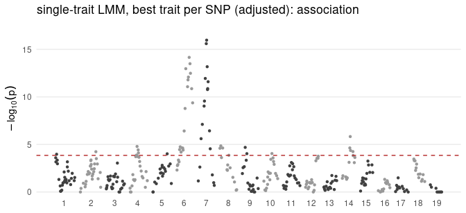
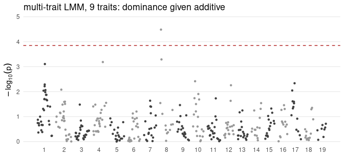
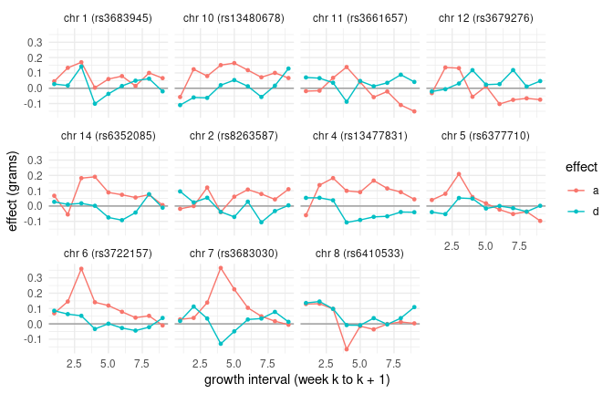

This vignette scans the genome of the LG/SM F3 mice for loci affecting nine
weekly weight gains: jointly across the nine traits, trait by trait, and for
dominance. It uses the `G` and `E` estimated in the vignette
*Estimating G for many traits*, and was precomputed.

## Setup


``` r
# The data every vignette uses: the nine weekly weight gains of the LG/SM F3
# mice, with the fixed effects of the original analyses.
library(indri)
traits <- lgsm_traits$growth
d <- lgsm_f3[lgsm_f3$ID %in% rownames(lgsm_genotypes$A), ]
d <- d[stats::complete.cases(d[c(traits, "LSB", "LSW")]), ]
Y <- as.matrix(d[traits])
rownames(Y) <- d$ID
X <- stats::model.matrix(~ SEX + factor(COHORT) + LSB + LSW, d)
rownames(X) <- d$ID
A <- lgsm_A[rownames(Y), rownames(Y)]
dosage <- lgsm_genotypes$A[rownames(Y), ] + 1
info <- transform(lgsm_markers, pos = cM)
cores <- as.integer(Sys.getenv("INDRI_VIGNETTE_CORES", "2"))
dir.create("cache", showWarnings = FALSE)
```


``` r
fit <- if (file.exists("cache/fit_sommer.rds")) readRDS("cache/fit_sommer.rds") else
  fit_G(Y, X = X, A = A, engine = "sommer", cores = cores, seed = 1L,
        progress = FALSE)
c(mice = nrow(Y), traits = ncol(Y), markers = ncol(dosage))
#>    mice  traits markers 
#>    1548       9     353
```

The genotypes are the additive coding of `lgsm_genotypes` plus one: 0, 1 and
2 copies of one parental allele. `info` places the 353 markers on the
genetic map (cM).

## The multi-trait scan

One test per marker against all nine traits at once, in a linear mixed model
whose covariance is `G` and `E` with the relationship matrix `A`:


``` r
multi <- indri_gwas(Y, dosage, fit = fit, A = A, X = X, snp_info = info)
multi
#> indri association scan: multi-trait LMM 
#>   353 SNPs, 9 traits, 1548 individuals
#>   null variance ratio delta: 0.997
#>   smallest p-value: 5.16e-20
summary(multi, n = 8)
#> indri association scan: multi-trait LMM 
#>   353 SNPs tested
#>   genomic inflation (lambda_gc): 2.318
#> 
#> smallest p-values:
#>            snp chrom    cM        bp   pos    pvalue
#>      rs3683030     7 39.86  92968513 39.86 5.161e-20
#>     rs13479385     7 38.13  87009942 38.13 6.253e-19
#>      rs3722157     6 58.30 122444202 58.30 1.963e-18
#>      rs6199136     6 70.18 140483280 70.18 8.818e-18
#>     rs13479024     6 62.19 127614936 62.19 3.542e-17
#>      rs6339546     6 64.45 133981207 64.45 1.653e-16
#>  gnf07.056.997     7 27.70  56324216 27.70 5.551e-16
#>    mCV23042866     6 54.62 117194262 54.62 5.887e-16
```

`delta` is the ratio between `E` and `G` that the scan re-fits under the
null; at 0.997 it says the `G` and `E` from `fit_G()`
describe the data being scanned. The genomic inflation factor `lambda_gc`
compares the median test statistic with its null expectation, here
2.32. That is not a miscalibrated test: in
a cross between lines selected for size every chromosome carries loci, and
in an F3 each marker is linked to long stretches of its chromosome, so most
markers are associated with growth. The calibration of these tests on
simulated null markers is in STATUS.md.


``` r
threshold <- 0.05 / ncol(dosage)
plot(multi, threshold = threshold)
```



The dashed line is the Bonferroni threshold for 353 markers. Markers in an
F3 are strongly linked, so a QTL lifts a whole stretch of chromosome; a
region, not a single marker, is the unit of discovery.

## Trait by trait


``` r
single <- indri_gwas(Y, dosage, A = A, X = X, snp_info = info,
                     mode = "single_trait", adjust = "effective")
single$n_tests
#> [1] 8.741756
plot(single, threshold = threshold)
```



The single-trait tests are adjusted for the number of traits by their
effective number (Galwey 2009), counted from the correlations of the traits
after the fixed effects. Each marker's smallest adjusted p-value is plotted.


``` r
hits <- data.frame(
  multi_trait = sum(multi$pvalues <= threshold),
  single_trait = sum(apply(single$pvalues_adjust, 1, min) <= threshold),
  both = sum(multi$pvalues <= threshold &
               apply(single$pvalues_adjust, 1, min) <= threshold))
hits
#>   multi_trait single_trait both
#> 1          78           49   44
```

At the Bonferroni threshold the joint test finds
78 markers and the single-trait tests 49,
44 of them in common. The joint test gains where a locus has
modest effects on several traits; a single-trait test gains where one trait
carries all of the effect. In
simulations the joint test was the more powerful one for most patterns of
effects (STATUS.md), with the largest gains when the effects run against
the correlations between traits.

## Empirical thresholds

Permuting the genotypes across mice gives empirical p-values and a
permutation estimate of the false discovery rate:


``` r
perm <- indri_gwas(Y, dosage, fit = fit, A = A, X = X, snp_info = info,
                   n_permutations = 999L, fdr = 0.05, seed = 1L, cores = cores)
perm$fdr_threshold
#> [1] 0.02619424
sum(perm$qvalues_empirical <= 0.05)
#> [1] 182
```

At a false discovery rate of 5%, 182 of
the 353 markers are discoveries: linkage again, each QTL
carrying its neighbours. Permuting genotypes across relatives ignores their
relatedness (the permuted genotypes no longer follow the pedigree), so treat
these as a check on the analytic p-values, not a replacement.

## Dominance

In an F3 the three genotypes occur at about 1/4, 1/2 and 1/4 at every marker,
so dominance is estimable everywhere:


``` r
dom <- indri_gwas(Y, dosage, fit = fit, A = A, X = X, snp_info = info,
                  dominance = TRUE)
c(estimable = sum(dom$dominance_estimable),
  dominance_hits = sum(dom$pvalues_dominance <= threshold, na.rm = TRUE))
#>      estimable dominance_hits 
#>            353              1
plot(dom, which = "dominance", threshold = threshold)
```



Dominance is rare in these data: 1
marker passes the Bonferroni threshold for dominance given the additive
effect. `pvalues` is now the joint test of the additive and dominance
effects, and `pvalues_dominance` tests dominance given the additive effect. `a` is the
effect of one allele copy (half the difference between the homozygotes) and
`d` the deviation of the heterozygote from their midpoint.

## Effects across the growth curve

The additive and dominance effects at the strongest marker of each
chromosome with a signal, across the nine weeks:


``` r
best <- tapply(seq_along(dom$pvalues), info$chrom, function(i)
  i[which.min(dom$pvalues[i])])
best <- best[dom$pvalues[best] <= threshold]
effects <- do.call(rbind, lapply(best, function(j) rbind(
  data.frame(marker = info$snp[j], chrom = info$chrom[j], effect = "a",
             week = seq_along(traits), value = dom$a[j, ]),
  data.frame(marker = info$snp[j], chrom = info$chrom[j], effect = "d",
             week = seq_along(traits), value = dom$d[j, ]))))
effects$label <- paste0("chr ", effects$chrom, " (", effects$marker, ")")
library(ggplot2)
ggplot(effects, aes(week, value, colour = effect)) +
  geom_hline(yintercept = 0, colour = "grey60") +
  geom_line() + geom_point(size = 1) +
  facet_wrap(~ label) +
  labs(x = "growth interval (week k to k + 1)", y = "effect (grams)") +
  theme_minimal()
```



Additive effects concentrated early or late in growth separate loci acting on
early and late growth, the pattern the original analysis of these mice
reported for the first seven intervals (Melo, Marroig and Wolf 2019).


## Summary

- One joint test per marker across nine traits, in a mixed model with `G`,
  `E` and `A`.
- Single-trait tests adjusted for the effective number of traits.
- Dominance and additive effects together, and their profiles across the
  growth curve.

## References

Galwey, N. W. (2009). A new measure of the effective number of tests.
*Genetic Epidemiology* 33, 559-568.

Melo, D., Marroig, G. and Wolf, J. B. (2019). Genomic perspective on
multivariate variation, pleiotropy, and evolution. *Journal of Heredity*
110, 479-493. <https://doi.org/10.1093/jhered/esz011>
