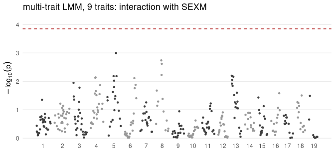
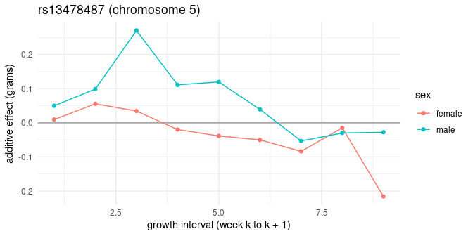

Do loci affect growth differently in males and females? This vignette treats
sex as the environment: it estimates the genetic covariance of growth within
and between the sexes, and scans for genotype-by-sex interactions with two
backgrounds. It builds on the vignettes *Estimating G for many traits* and
*Genome scans for many traits*, and was precomputed.

**Two features here are experimental.** `fit_G_env()` estimates the genetic
covariance between environments, and in simulations it estimated
cross-environment genetic correlations too low (0.67-0.77 where the truth was
1). Scans that use it are conservative for interactions: they do not report
too many interactions, but they miss some.

## Setup


``` r
# The data every vignette uses: the nine weekly weight gains of the LG/SM F3
# mice, with the fixed effects of the original analyses.
library(indri)
traits <- lgsm_traits$growth
d <- lgsm_f3[lgsm_f3$ID %in% rownames(lgsm_genotypes$A), ]
d <- d[stats::complete.cases(d[c(traits, "LSB", "LSW")]), ]
Y <- as.matrix(d[traits])
rownames(Y) <- d$ID
X <- stats::model.matrix(~ SEX + factor(COHORT) + LSB + LSW, d)
rownames(X) <- d$ID
A <- lgsm_A[rownames(Y), rownames(Y)]
dosage <- lgsm_genotypes$A[rownames(Y), ] + 1
info <- transform(lgsm_markers, pos = cM)
cores <- as.integer(Sys.getenv("INDRI_VIGNETTE_CORES", "2"))
dir.create("cache", showWarnings = FALSE)
```


``` r
fit <- if (file.exists("cache/fit_sommer.rds")) readRDS("cache/fit_sommer.rds") else
  fit_G(Y, X = X, A = A, engine = "sommer", cores = cores, seed = 1L,
        progress = FALSE)
table(d$SEX)
#> 
#>   F   M 
#> 739 809
table(tapply(d$SEX, d$FAMILY, function(s) length(unique(s))))
#> 
#>   1   2 
#>   8 187
```

Almost every family has mice of both sexes: relatives of different sex are
what make the genetic covariance between the sexes estimable.

## Genetic covariance within and between the sexes

`fit_G_env()` treats each trait in each sex as its own trait (a "character
state"): `growth12:F` is observed in females, `growth12:M` in males. Its `G`
holds the genetic covariance within each sex and between the sexes. The
environment's main effect is in the states' own means, so the sex column of
`X` is left out:


``` r
fit_env <- fit_G_env(Y, env = d$SEX, X = X[, colnames(X) != "SEXM"], A = A,
                     cores = cores, seed = 1L, progress = FALSE)
fit_env
#> indri environment-specific G (experimental): 9 traits in 2 environments ( F, M )
#> genetic correlation of each trait between environments:
#>             F-M
#> growth12  0.918
#> growth23  0.951
#> growth34  0.518
#> growth45  0.917
#> growth56  0.496
#> growth67  0.787
#> growth78  0.346
#> growth89  0.565
#> growth910 0.571
```

`corr_between` is each trait's genetic correlation between the sexes. A value
of 1 means the same genes act in both sexes in the same way; below 1, the
genetic effects differ between the sexes: genotype-by-sex interaction in the
polygenic background. Here they run from
0.35 to
0.95. Given the downward bias above,
values somewhat below 1 are not by themselves evidence of interaction; the
lowest ones are the most suggestive.


``` r
round(sqrt(diag(fit_env$G)), 2)
#>  growth12:F  growth23:F  growth34:F  growth45:F  growth56:F  growth67:F 
#>        0.54        0.86        0.93        0.88        0.53        0.54 
#>  growth78:F  growth89:F growth910:F  growth12:M  growth23:M  growth34:M 
#>        0.64        0.65        0.55        0.49        0.90        0.95 
#>  growth45:M  growth56:M  growth67:M  growth78:M  growth89:M growth910:M 
#>        1.11        0.87        0.74        0.61        0.58        0.67
```

## Why the background matters for an interaction scan

An interaction scan asks, for each marker, whether its effect differs between
the sexes. If the polygenic background has genotype-by-sex interaction and
the scan's covariance ignores it, markers that track the relatedness of the
mice pick some of it up, and the interaction test reports too many hits. In
simulations (STATUS.md) a cross-sex genetic correlation of 0.5 raised the
genomic inflation of the interaction test to about 1.14; scanning with the
environment-specific covariance from `fit_G_env()` brought it to 0.94-0.98.

## Two scans

The usual background (`G` and `E` from `fit_G()`) and the
environment-specific one, both with `gxe = "SEXM"`: each marker's dosage also
enters multiplied by the male indicator.


``` r
usual <- indri_gwas(Y, dosage, fit = fit, A = A, X = X, snp_info = info,
                    gxe = "SEXM")
time_env <- system.time(
  by_sex <- indri_gwas(Y, dosage, fit = fit_env, A = A, X = X,
                       snp_info = info, gxe = "SEXM"))
lambda <- function(p, df) qchisq(median(p, na.rm = TRUE), df, lower.tail = FALSE) /
  qchisq(0.5, df, lower.tail = FALSE)
data.frame(background = c("usual", "environment-specific"),
           lambda_interaction = round(c(lambda(usual$pvalues_gxe, ncol(Y)),
                                        lambda(by_sex$pvalues_gxe, ncol(Y))), 3),
           delta = round(c(usual$delta, by_sex$delta), 2))
#>             background lambda_interaction delta
#> 1                usual              1.560  1.00
#> 2 environment-specific              1.292  1.02
time_env[["elapsed"]]
#> [1] 24.37
```

`pvalues_gxe` tests the interaction given the marker's main effect, with nine
degrees of freedom (one per trait); `pvalues` is the joint test of the main
effect and the interaction.


``` r
threshold <- 0.05 / ncol(dosage)
plot(by_sex, which = "gxe", threshold = threshold)
```




``` r
gxe_hits <- c(usual = sum(usual$pvalues_gxe <= threshold, na.rm = TRUE),
              environment_specific = sum(by_sex$pvalues_gxe <= threshold,
                                         na.rm = TRUE))
gxe_hits
#>                usual environment_specific 
#>                    0                    0
```

The interaction tests are inflated with either background (genomic
inflation 1.56 with the usual
one, 1.29 with the
environment-specific one), and the environment-specific background removes
part of it, as in the simulations. What remains may be genotype-by-sex
interaction spread over many linked loci, or variance the model does not
have, such as litter effects that differ between the sexes. No marker
passes the Bonferroni threshold with either background
(0 and 0): these
data give no strong evidence of single loci acting differently in males and
females.

## Sex-specific effects

`a` is a marker's effect where the environment column is 0 (females), and
`a + gxe` its effect in males. At the marker with the strongest interaction,
which is not significant, the two profiles show what an interaction would
look like:


``` r
j <- which.min(by_sex$pvalues_gxe)
effects <- rbind(
  data.frame(sex = "female", week = seq_along(traits), effect = by_sex$a[j, ]),
  data.frame(sex = "male", week = seq_along(traits),
             effect = by_sex$a[j, ] + by_sex$gxe[j, , "SEXM"]))
library(ggplot2)
ggplot(effects, aes(week, effect, colour = sex)) +
  geom_hline(yintercept = 0, colour = "grey60") +
  geom_line() + geom_point() +
  labs(title = paste0(info$snp[j], " (chromosome ", info$chrom[j], ")"),
       x = "growth interval (week k to k + 1)",
       y = "additive effect (grams)") +
  theme_minimal()
```



## Cost

The environment-specific covariance is not a Kronecker product, so the scan
cannot use the single rotation of the usual one. It rotates by a generalized
eigendecomposition once per group of related mice instead, which keeps it
fast for family data like these (seconds here) and makes it expensive for a
dense genomic relationship matrix.

## Summary

- `fit_G_env()` estimates genetic covariance within and between the sexes;
  its cross-sex correlations are currently biased low.
- Interaction scans need a background that allows genotype-by-sex
  interaction, or they report too many interactions; with `fit_G_env()`'s
  covariance they are conservative instead.
- Dominance enters such scans as a main effect only.
