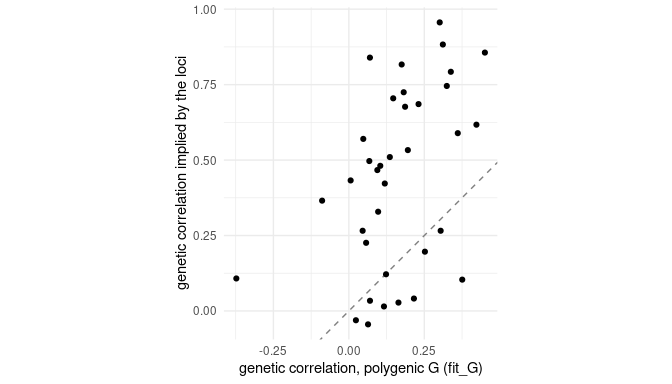

How much of the genetic covariance between traits do the mapped loci explain?
`indri_locus_G()` turns the additive and dominance effects of loci into the
covariance matrices they imply (Melo, Marroig and Wolf 2019). This vignette
applies it to the loci found in the vignette *Genome scans for many traits*
and compares the result with the polygenic `G` of *Estimating G for many
traits*. It was precomputed.

## The idea

A locus with allele frequency `p` (and `q = 1 - p`), additive effects `a` and
dominance effects `d` across the traits contributes `2pq α α'` to the
additive covariance matrix `G`, where `α = a + (q - p) d` is the average
effect of an allele substitution, and `(2pq)² d d'` to the dominance matrix
`D`. Loci in linkage disequilibrium add cross terms. Summing over loci gives
the `G` and `D` the loci imply.

## Setup


``` r
# The data every vignette uses: the nine weekly weight gains of the LG/SM F3
# mice, with the fixed effects of the original analyses.
library(indri)
traits <- lgsm_traits$growth
d <- lgsm_f3[lgsm_f3$ID %in% rownames(lgsm_genotypes$A), ]
d <- d[stats::complete.cases(d[c(traits, "LSB", "LSW")]), ]
Y <- as.matrix(d[traits])
rownames(Y) <- d$ID
X <- stats::model.matrix(~ SEX + factor(COHORT) + LSB + LSW, d)
rownames(X) <- d$ID
A <- lgsm_A[rownames(Y), rownames(Y)]
dosage <- lgsm_genotypes$A[rownames(Y), ] + 1
info <- transform(lgsm_markers, pos = cM)
cores <- as.integer(Sys.getenv("INDRI_VIGNETTE_CORES", "2"))
dir.create("cache", showWarnings = FALSE)
```


``` r
fit <- if (file.exists("cache/fit_sommer.rds")) readRDS("cache/fit_sommer.rds") else
  fit_G(Y, X = X, A = A, engine = "sommer", cores = cores, seed = 1L,
        progress = FALSE)
dom <- if (file.exists("cache/scan_dominance.rds")) readRDS("cache/scan_dominance.rds") else
  indri_gwas(Y, dosage, fit = fit, A = A, X = X, snp_info = info,
             dominance = TRUE)
```

## Choosing the loci

Markers in an F3 are strongly linked, so the effects of neighbouring markers
mostly measure the same QTL. Taking every significant marker would count each
QTL many times; one marker per peak, the strongest of each chromosome with a
signal, avoids that:


``` r
threshold <- 0.05 / ncol(dosage)
best <- tapply(seq_along(dom$pvalues), info$chrom, function(i)
  i[which.min(dom$pvalues[i])])
loci <- info$snp[best[dom$pvalues[best] <= threshold]]
loci
#>  [1] "rs3683945"  "rs8263587"  "rs13477831" "rs6377710"  "rs3722157" 
#>  [6] "rs3683030"  "rs6410533"  "rs13480678" "rs3661657"  "rs3679276" 
#> [11] "rs6352085"
```

## G and D from those loci


``` r
locus <- indri_locus_G(dom$a[loci, , drop = FALSE], dom$d[loci, , drop = FALSE], genotypes = dosage)
round(sqrt(diag(locus$G)), 3)
#>  growth12  growth23  growth34  growth45  growth56  growth67  growth78  growth89 
#>     0.140     0.250     0.427     0.380     0.249     0.234     0.147     0.177 
#> growth910 
#>     0.180
round(cov2cor(locus$G), 2)
#>           growth12 growth23 growth34 growth45 growth56 growth67 growth78
#> growth12      1.00     0.23     0.43     0.03     0.10     0.03     0.01
#> growth23      0.23     1.00     0.75     0.11     0.50     0.37     0.27
#> growth34      0.43     0.75     1.00     0.51     0.72     0.57     0.47
#> growth45      0.03     0.11     0.51     1.00     0.86     0.62     0.53
#> growth56      0.10     0.50     0.72     0.86     1.00     0.79     0.70
#> growth67      0.03     0.37     0.57     0.62     0.79     1.00     0.96
#> growth78      0.01     0.27     0.47     0.53     0.70     0.96     1.00
#> growth89      0.20     0.42     0.48     0.33     0.59     0.88     0.84
#> growth910    -0.04     0.12     0.04    -0.03     0.27     0.68     0.69
#>           growth89 growth910
#> growth12      0.20     -0.04
#> growth23      0.42      0.12
#> growth34      0.48      0.04
#> growth45      0.33     -0.03
#> growth56      0.59      0.27
#> growth67      0.88      0.68
#> growth78      0.84      0.69
#> growth89      1.00      0.82
#> growth910     0.82      1.00
```

The allele frequencies and the linkage disequilibrium between the chosen
loci come from the genotypes (`ld = TRUE`, the default), so loci on the same
chromosome are not counted as independent.

How much of the genetic variance of each trait do they account for?


``` r
share <- diag(locus$G) / diag(fit$G)
round(share, 2)
#>  growth12  growth23  growth34  growth45  growth56  growth67  growth78  growth89 
#>      0.07      0.08      0.28      0.14      0.15      0.15      0.08      0.10 
#> growth910 
#>      0.11
```

The 11 loci account for 7 to
28% of each trait's genetic variance: the rest is
spread over loci too small to map here. Their genetic correlations are much
stronger than the polygenic ones: a few large loci, each affecting several
weeks of growth, make a tightly integrated `G`.

## Comparing with the polygenic G


``` r
options(rgl.useNULL = TRUE)
suppressPackageStartupMessages(library(evolqg))
compare <- function(x, y) c(
  random_skewers = RandomSkewers(x, y)[[1]],
  krzanowski = unname(KrzCor(x, y, ret.dim = 4)),
  correlation_of_entries = cor(cov2cor(x)[upper.tri(x)], cov2cor(y)[upper.tri(y)]))
round(rbind(`loci G vs polygenic G` = compare(locus$G, fit$G),
            `loci D vs loci G` = compare(locus$D + diag(1e-8, nrow(locus$D)), locus$G)), 2)
#>                       random_skewers krzanowski correlation_of_entries
#> loci G vs polygenic G           0.79       0.75                   0.43
#> loci D vs loci G                0.55       0.63                   0.34
```

Random skewers compares the responses of the two matrices to the same random
selection gradients; Krzanowski's statistic the subspaces of their first four
principal components. Despite the difference in strength, the loci's `G` responds to selection much
like the polygenic one (random skewers
0.79): the mapped loci
reproduce the main directions of genetic covariance, if not its spread.


``` r
library(ggplot2)
entries <- data.frame(polygenic = cov2cor(fit$G)[upper.tri(fit$G)],
                      loci = cov2cor(locus$G)[upper.tri(locus$G)])
ggplot(entries, aes(polygenic, loci)) +
  geom_abline(linetype = "dashed", colour = "grey50") +
  geom_point() + coord_equal() +
  labs(x = "genetic correlation, polygenic G (fit_G)",
       y = "genetic correlation implied by the loci") +
  theme_minimal()
```



## With and without linkage disequilibrium


``` r
no_ld <- indri_locus_G(dom$a[loci, , drop = FALSE], dom$d[loci, , drop = FALSE], genotypes = dosage, ld = FALSE)
round(c(with_ld = sum(diag(locus$G)), without_ld = sum(diag(no_ld$G))), 4)
#>    with_ld without_ld 
#>     0.6101     0.5703
```

## Effects from other software

`indri_locus_G()` accepts effects from any mapping method, as a matrix or a
data frame with a column of marker names, with traits in columns or
(`traits_in = "rows"`) in rows. Its help page lists the conventions those
effects must follow: the effect allele must be the allele the genotypes
count, `d` the heterozygote's deviation from the homozygote midpoint, and the
units those of the traits.


``` r
effects <- data.frame(marker = loci, dom$a[loci, , drop = FALSE])   # as another tool might give
other <- indri_locus_G(effects, genotypes = dosage)
all.equal(other$G, indri_locus_G(dom$a[loci, , drop = FALSE], genotypes = dosage)$G)
#> [1] TRUE
```

## Caveats

- Effects from a single-marker scan are marginal and, at the markers chosen
  for being significant, biased upwards (the winner's curse); a joint
  multi-locus model, as in the original analysis, gives better estimates.
- The loci found are those with large effects; many small ones make up the
  rest of `G`.

## Reference

Melo, D., Marroig, G. and Wolf, J. B. (2019). Genomic perspective on
multivariate variation, pleiotropy, and evolution. *Journal of Heredity*
110, 479-493. <https://doi.org/10.1093/jhered/esz011>
